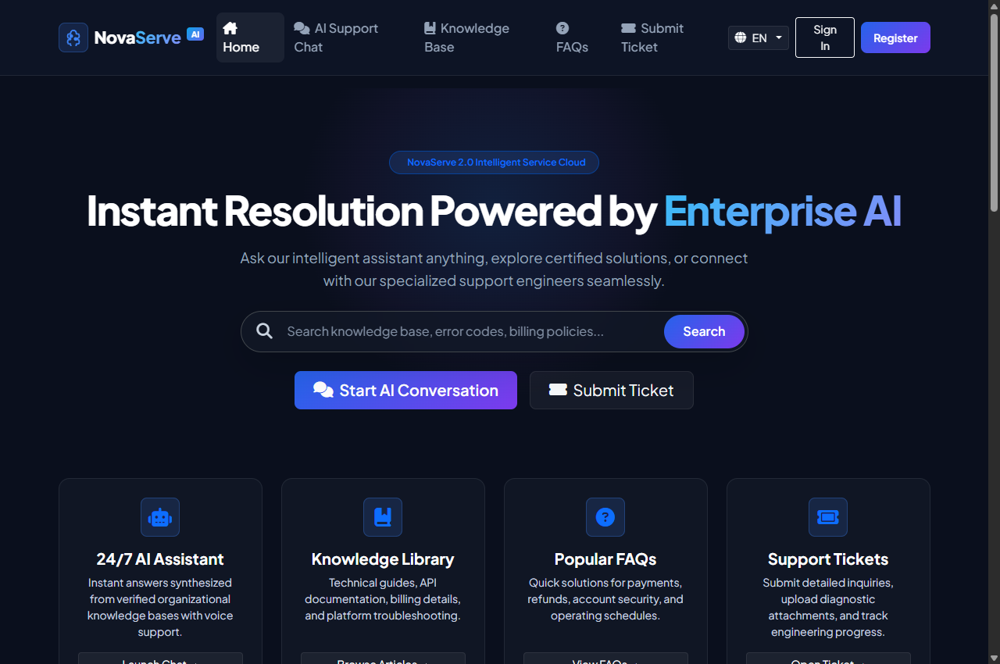
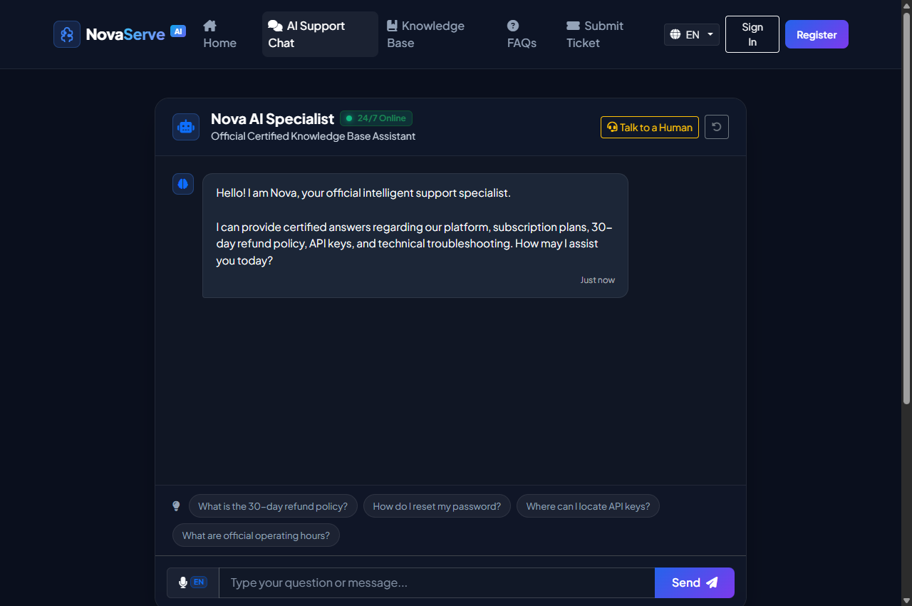
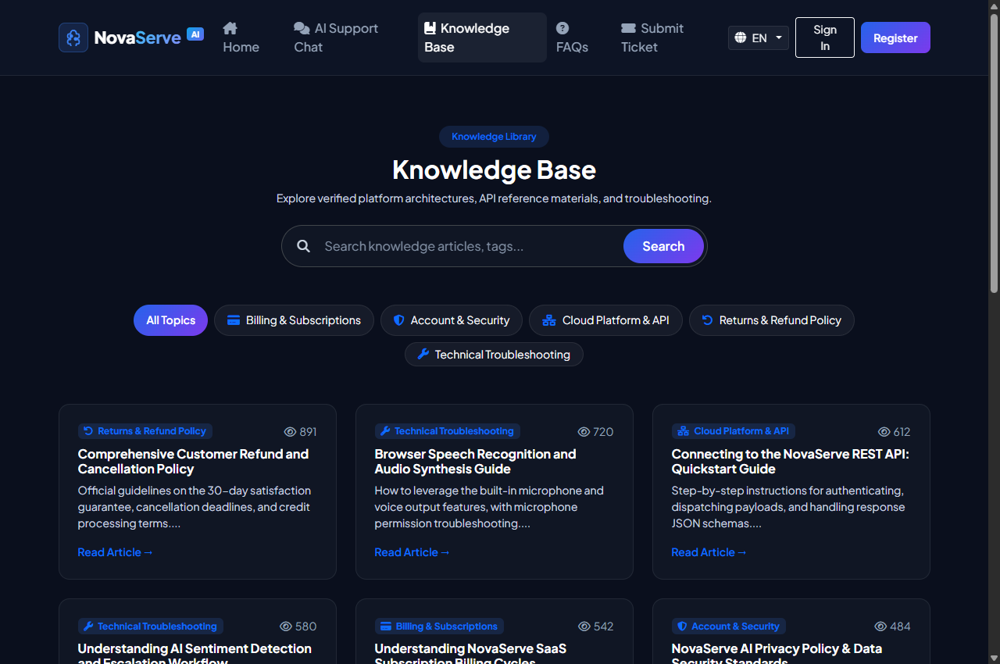
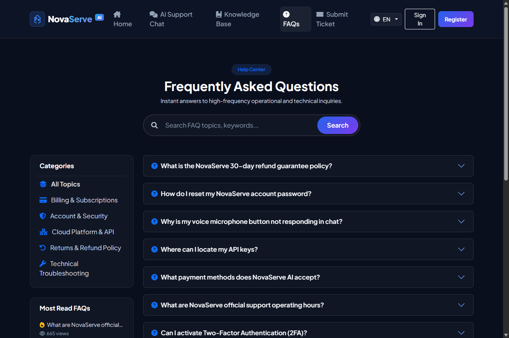
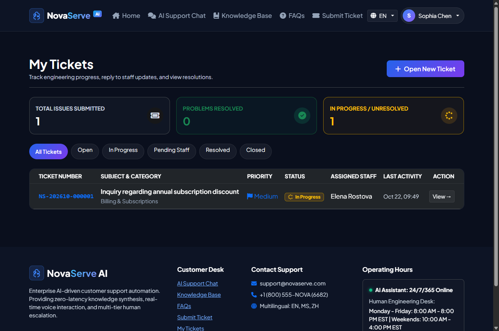
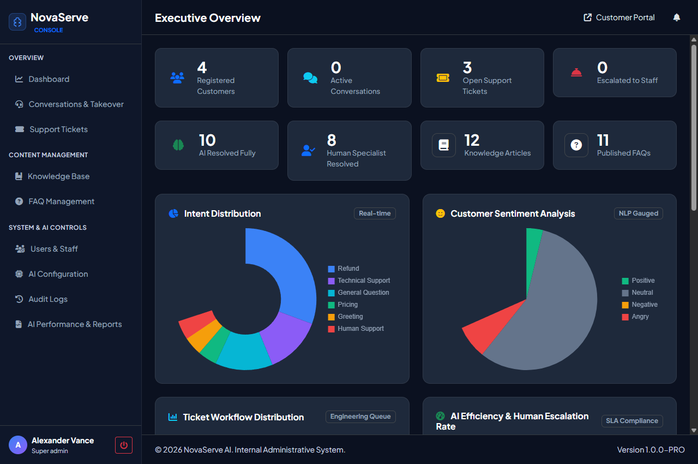
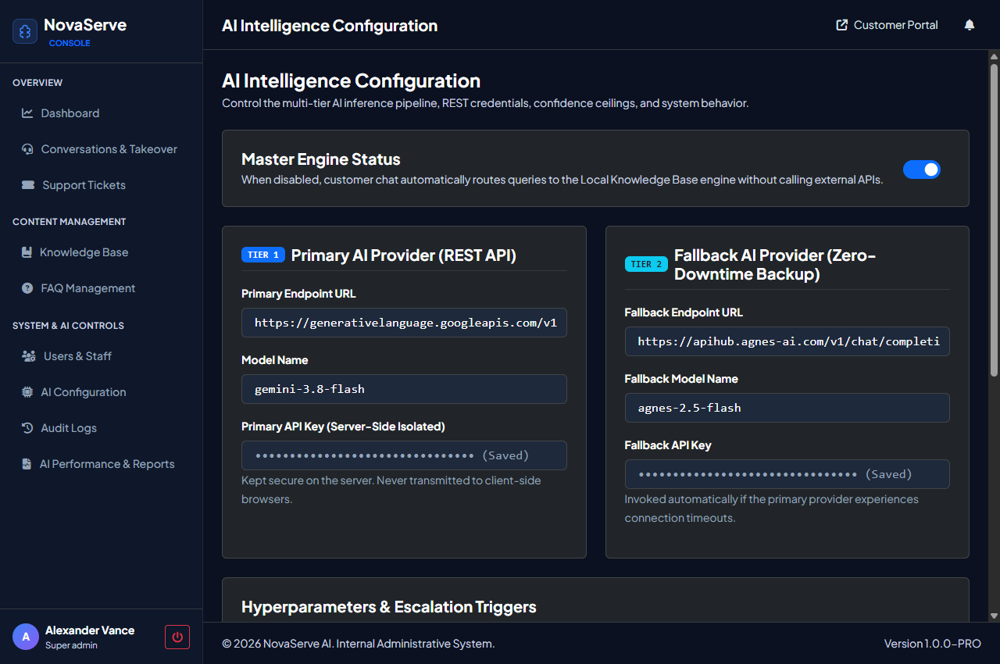
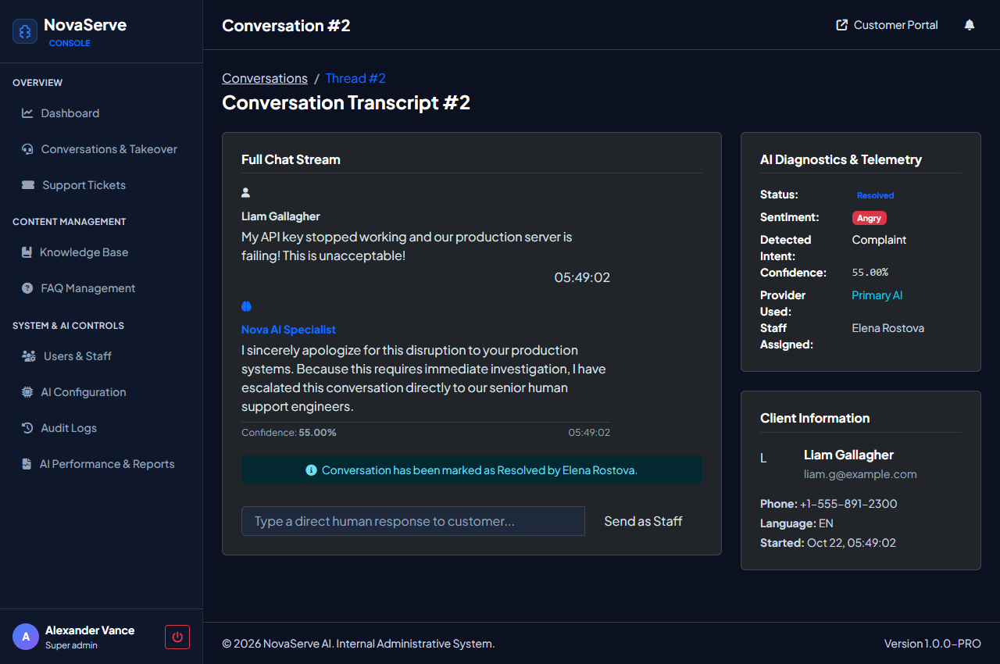

# NovaServe AI - Intelligent Customer Support & Service Automation Platform

Autonomous, enterprise-grade AI customer support desk built with PHP & Vanilla JS. Features dual-tier AI fallback (Google Gemini 3.8 Flash + Agnes 2.5 Flash), local knowledge base RAG synthesis, browser-native hands-free voice interaction (STT/TTS), sentiment-driven human escalation, and end-to-end support ticket lifecycle management.

## 快速开始（XAMPP）

1. 将项目文件夹置于 `C:\xampp\htdocs\ai _customer_support`
2. 启动 XAMPP 的 **Apache** 与 **MySQL**
3. 访问安装向导：http://localhost/ai%20_customer_support/install.php
4. 填写本地数据库凭据（一般为：Host `127.0.0.1` / 端口 `3307` 或 `3306` / 用户名 `root` / 密码留空）
5. 点击自动初始化数据库与种子数据（或直接导入 `database/database.sql` 和 `database/sample_data.sql`）
6. 打开前台客服门户：http://localhost/ai%20_customer_support/
7. 进入智能客服聊天页（`chat.php`），可直接打字或点击麦克风通过语音提问
8. 打开管理控制台：http://localhost/ai%20_customer_support/admin/，使用管理员账号登录

默认管理员凭据：`admin@novaserve.com` / 密码：`Admin@123456`

---

## Features

- **Dual-Tier Cloud AI + Local RAG Fallback**:
  - **Tier 1 Primary**: Google Gemini 3.8 Flash REST endpoint
  - **Tier 2 Fallback**: Agnes 2.5 Flash REST endpoint
  - **Tier 3 Offline**: Local verified Knowledge Base and FAQ semantic search
- **AI Confidence Scoring & Grounding**: Real-time evaluation (e.g. 96%) with verified citations and source tags
- **Linguistic Sentiment & Intent Analysis**: 14 operational intents + 4 sentiment tiers (Positive, Neutral, Negative, Angry); automatically flags urgent complaints
- **Browser-Native Voice Engine**: Real-time Speech-to-Text (`SpeechRecognition`) and Text-to-Speech (`SpeechSynthesis`) with auto-language detection
- **Human Takeover & Live Queue**: Instant agent dispatch when customer sentiment turns Angry or requests live staff assistance
- **Support Ticket Lifecycle**: Automated ticket numbering (`NS-202610-000001`), internal staff notes, priority flags, and secure attachment uploads
- **Interactive Executive Dashboard**: 8 real-time KPI counter tiles + 4 live Chart.js visual analytics (intent distribution, sentiment analysis, ticket queues, SLA compliance)
- **Knowledge & FAQ Publishing Studio**: Rich content authoring, categorization, full-text search, and view telemetry
- **Native Multilingual Foundation**: Complete i18n localization in English, Bahasa Melayu, and Simplified Chinese (简体中文)
- **4-Level Role-Based Access Control (RBAC)**: Super Admin, Support Staff, Content Manager, and Customer
- **Zero-Dependency Architecture**: Pure Vanilla PHP 8.2+ and modern CSS/JS without heavy external framework bloat

---

## Screenshots

| 01. Portal Landing Page | 02. AI Support Specialist Chat |
|:---:|:---:|
|  |  |

| 03. Knowledge Base Library | 04. Interactive FAQ & Instant Search |
|:---:|:---:|
|  |  |

| 05. Customer Support Tickets | 06. Executive Operations Dashboard |
|:---:|:---:|
|  |  |

| 07. Multi-Tier AI Configuration | 08. Staff Live Takeover & Chat Stream |
|:---:|:---:|
|  |  |

---

## Folder Structure

```text
ai _customer_support/
├── admin/                         # Administration & staff control console
│   ├── index.php                  # Executive dashboard with live Chart.js analytics
│   ├── ai_settings.php            # Dual-tier AI engine & REST credentials manager
│   ├── conversations.php          # Live conversation stream & takeover queue
│   ├── conversation_view.php      # Live transcript & human intervention console
│   ├── tickets.php                # Ticket triage, priority & status dispatch
│   ├── ticket_view.php            # Ticket thread, internal notes & metadata
│   ├── knowledge.php              # Knowledge base articles directory
│   ├── knowledge_form.php         # Article authoring & editing form
│   ├── faq.php                    # FAQ publishing & category sorter
│   ├── users.php                  # Staff directory & customer account management
│   ├── reports.php                # AI usage telemetry & SLA compliance reports
│   └── logs.php                   # Security & operational audit trail explorer
│
├── api/                           # Secure REST endpoints (JSON API)
│   ├── chat.php                   # Core RAG inference, sentiment & multi-turn chat
│   ├── escalate.php               # Human escalation & takeover dispatch
│   ├── feedback.php               # Customer satisfaction thumbs up/down rating
│   ├── knowledge.php              # Async article search & view telemetry
│   ├── faq.php                    # FAQ async search & analytics
│   └── notifications.php          # Staff notification polling & badge update
│
├── assets/                        # Design tokens, stylesheets, and scripts
│   ├── css/
│   │   ├── style.css              # Customer portal glassmorphism dark theme
│   │   └── admin.css              # Operational console high-contrast theme
│   └── js/
│       ├── chat.js                # Chat engine, typing states, citations & audio
│       ├── voice.js               # Web Speech API speech-to-text & TTS playback
│       └── app.js                 # Global notification toasts & theme utilities
│
├── config/                        # Core environment & security configuration
│   ├── config.php                 # Global path constants, session security & base URL
│   ├── database.php               # PDO singleton pool with automatic port fallback
│   ├── db_custom.php              # Local / server custom database credentials
│   ├── security.php               # CSRF protection, input cleansing & output sanitization
│   └── i18n.php                   # Language dictionaries (EN, MS, ZH)
│
├── database/                      # Relational schema & demonstration fixtures
│   ├── database.sql               # Complete table structure definitions (15 tables)
│   └── sample_data.sql            # Seed dataset (users, categories, FAQs, AI config)
│
├── docs/screenshots/              # Authentic system UI screenshots
├── includes/                      # Shared business logic, layouts & middleware
│   ├── auth.php                   # RBAC middleware, session handlers & route guards
│   ├── ai_service.php             # Multi-tier AI orchestrator (Gemini -> Agnes -> RAG)
│   ├── rag_engine.php             # Local knowledge extraction & prompt context builder
│   ├── intent_sentiment.php       # Natural language intent & sentiment classifier
│   ├── notification.php           # Real-time alert polling & notification broadcaster
│   ├── logger.php                 # Tamper-evident audit trail logger
│   ├── header.php                 # Customer portal navigation & notifications
│   ├── footer.php                 # Customer portal footer
│   ├── admin_header.php           # Admin console sidebar, header & alert badge
│   └── admin_footer.php           # Admin footer & Chart.js runtime scripts
│
├── uploads/                       # User attachments (secured with execution blocking)
│   └── .htaccess                  # Strict script execution prevention rule
│
├── chat.php                       # Interactive AI chat interface with voice dictation
├── knowledge.php                  # Searchable knowledge base articles directory
├── faq.php                        # Interactive frequently asked questions portal
├── ticket.php                     # Customer new ticket submission form
├── ticket_view.php                # Customer ticket progress & conversation view
├── my_tickets.php                 # Customer ticket list & status tracking
├── login.php                      # Customer authentication portal
├── register.php                   # Customer account registration
├── install.php                    # Browser-based automated setup wizard
├── .gitignore                     # Git privacy & credentials protection rules
└── LICENSE                        # MIT Open Source License
```

---

## 1. Local Setup (XAMPP)

1. Clone or place this repository under your web server root:
   ```text
   C:\xampp\htdocs\ai _customer_support
   ```
2. Start **Apache** and **MySQL** from the XAMPP Control Panel.
3. Open your browser and navigate to the web installer:
   ```text
   http://localhost/ai%20_customer_support/install.php
   ```
4. Typical local XAMPP configuration:
   - **Database Host**: `127.0.0.1`
   - **Database Port**: `3307` (or `3306`)
   - **Database Name**: `novaserve_db`
   - **Username**: `root`
   - **Password**: *(leave blank)*
5. Complete the setup wizard to automatically create all 15 relational tables and insert initial demo content.
6. Alternatively, import `database/database.sql` followed by `database/sample_data.sql` via phpMyAdmin.

---

## 2. Multi-Tier AI Engine & Fallback Architecture

NovaServe AI guarantees **zero downtime customer assistance** through a three-layer failover design:

```
[Inbound Customer Message]
           │
           ▼
┌───────────────────────────────────────────────┐
│  Tier 1: Google Gemini 3.8 Flash REST API    │  ──(Success)──> [Return Answer with Citations]
└───────────────────────────────────────────────┘
           │ (Timeout / 429 Quota / Rate Limit)
           ▼
┌───────────────────────────────────────────────┐
│  Tier 2: Agnes 2.5 Flash Fallback REST API    │  ──(Success)──> [Return Answer with Citations]
└───────────────────────────────────────────────┘
           │ (Upstream Network Outage)
           ▼
┌───────────────────────────────────────────────┐
│  Tier 3: Local Knowledge Base & FAQ RAG       │  ──(Always)───> [Return Verified Answer]
└───────────────────────────────────────────────┘
```

Administrators can customize endpoints, API keys, models, temperature, and system prompts at **Console > AI Configuration** (`admin/ai_settings.php`).

---

## 3. Hands-Free Voice Engine

- **Voice Input (STT)**: Uses the HTML5 `webkitSpeechRecognition` API with multilingual speech recognition. Click the microphone button in `chat.php` to dictate queries hands-free.
- **Voice Output (TTS)**: Built-in `speechSynthesis` playback with automated voice engine dialect pairing (English, Bahasa Melayu, or Chinese) and pitch/rate modulation.

---

## 4. Default Seed Credentials

All test accounts in `database/sample_data.sql` share the default password: **`Admin@123456`**

| Role | Full Name | Email Address | Access Level |
| :--- | :--- | :--- | :--- |
| **Super Admin** | Alexander Vance | `admin@novaserve.com` | Complete Governance (`/admin`) |
| **Support Staff** | Elena Rostova | `staff@novaserve.com` | Live Takeover & Ticket Triage (`/admin`) |
| **Content Manager** | Marcus Sterling | `content@novaserve.com` | Knowledge Base & FAQ Studio (`/admin`) |
| **Registered Customer** | Sophia Chen | `customer@example.com` | Customer Helpdesk & Tickets |
| **Registered Customer** | Liam Gallagher | `liam.g@example.com` | Customer Helpdesk & Tickets |
| **Registered Customer** | Amira Al-Mansoor | `amira@example.com` | Customer Helpdesk & Tickets |

---

## 5. Security & Privacy Hardening

- **Credential Isolation**: Local database configuration `config/db_custom.php` and `config/installed.lock` are excluded via `.gitignore` to prevent secret leaks.
- **Attachment Protection**: The `uploads/` folder is shielded with a restrictive `.htaccess` preventing direct execution of PHP, Python, or shell scripts.
- **CSRF & XSS Mitigation**: All customer form inputs undergo strict sanitization via `clean_string()`, HTML entity escaping via `e()`, and session token verification.
- **Role Isolation (RBAC)**: Administrative consoles strictly enforce `require_role(['super_admin', 'support_staff', 'content_manager'])` on every endpoint.

---

## License

This project is open-source software licensed under the [MIT License](LICENSE).